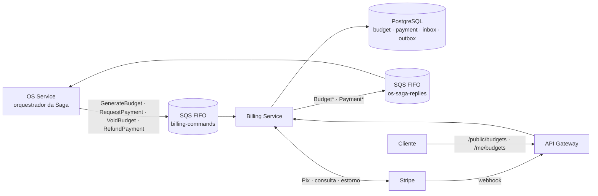

# Oficina — Billing Service

Microsserviço de **orçamento e pagamento** da oficina (Tech Challenge FIAP, Fase 4). Gera o orçamento e o envia ao
cliente, registra a decisão, cobra por **Pix (Stripe, modo de teste)**, confirma o pagamento e estorna quando a Saga pede.
Quem orquestra é o **OS Service**; este serviço só responde aos comandos e publica os fatos.

| | |
|---|---|
| Especificação | [`specs/fase4/05-billing-service-mercado-pago.md`](https://github.com/victor-duarte-mendonca/oficina-app/blob/homolog/specs/fase4/05-billing-service-mercado-pago.md) (no `oficina-app`) |
| Banco | **PostgreSQL** próprio (Flyway `V1__baseline.sql`) |
| Mensageria | SQS FIFO: consome `billing-commands`, publica em `os-saga-replies` |
| Pagamento | `PaymentGatewayPort` com dois adapters: **Stripe** (PaymentIntent, Pix em BRL) e **simulado** (dev/hml/testes) |
| Stack | Java 21, Quarkus 3.15.7, Hibernate ORM, SmallRye Fault Tolerance, AWS SDK v2, hexagonal |
| Outros repositórios | [`oficina-app`](https://github.com/victor-duarte-mendonca/oficina-app) (OS + Saga), [`oficina-execution-service`](https://github.com/victor-duarte-mendonca/oficina-execution-service), [`oficina-infra-k8s`](https://github.com/victor-duarte-mendonca/oficina-infra-k8s), [`oficina-infra-database`](https://github.com/victor-duarte-mendonca/oficina-infra-database), [`oficina-auth-lambda`](https://github.com/victor-duarte-mendonca/oficina-auth-lambda) |

## O que o serviço faz (e o que não faz)

- **Faz:** orçamento a partir dos itens da OS; envio por e-mail com código de autorização de uso único; decisão pelo
  link, pela área do cliente ou pelo atendimento; Pix com QR Code; confirmação por webhook **e** por reconciliação;
  expiração de orçamento e de Pix; estorno.
- **Não faz:** cadastro de cliente, veículo, peças ou OS (OS Service); fila de execução (Execution Service). Não lê o
  banco de outro serviço: itens e cliente chegam no comando `GenerateBudget`. O CPF/CNPJ **não** é copiado para cá.



## Papel na Saga

| Gatilho | Resposta | Observação |
|---|---|---|
| `GenerateBudget` | `BudgetGenerated{budgetId,total,expiresAt}` ou `BudgetGenerationFailed{reason}` | total ≠ soma dos itens é recusado; repetido pela mesma Saga → mesma resposta, sem novo e-mail |
| decisão do cliente/funcionário | `BudgetApproved{by}` / `BudgetRejected{by}` | `by` = `CLIENT_TOKEN`, `CLIENT_JWT` ou `STAFF`; mesma decisão repetida é idempotente |
| prazo de aprovação vencido (job, 60 s) | `BudgetExpired` | |
| `RequestPayment{budgetId,amount,attempt}` | `PaymentRequested{paymentId,expiresAt}` ou `PaymentRequestFailed{reason}` | valor tem de ser o total; a mesma tentativa nunca cobra duas vezes |
| webhook / reconciliação | `PaymentApproved` / `PaymentRejected` / `PaymentExpired` | a situação vem de **consulta** ao provedor; pagamento aprovado depois do prazo também é avisado (a Saga estorna o órfão) |
| `RefundPayment` (compensação) | `PaymentRefunded` ou `PaymentRefundFailed{detail}` | falha vira `REFUND_FAILED`; o retry manual da Saga abre nova tentativa |
| `VoidBudget` (compensação) | `BudgetVoided` | sempre confirma (inclusive orçamento inexistente) |

Contratos: [`contracts/`](contracts/) — este serviço é o dono de `billing-events.schema.json`; os demais são cópias.

## Banco: por que PostgreSQL

Dinheiro pede transação ACID, unicidade garantida pelo banco e trilha auditável. As duas regras mais importantes são
índices únicos parciais, que valem mesmo com duas réplicas e duas mensagens concorrentes:

| Regra | Como |
|---|---|
| Um orçamento vivo por OS | `ux_budget_active_work_order` (`status IN ('SENT','APPROVED')`) |
| Um pagamento ativo por orçamento | `ux_payment_active_budget` (`REQUESTED, PENDING, APPROVED, REFUND_PENDING`) — testado com duas transações concorrentes |
| Nenhuma cobrança duplicada | `idempotency_key` única, derivada de (orçamento, tentativa) e **gravada antes** de chamar o provedor |
| Token nunca em claro | `approval_token_hash` (SHA-256); comparação em tempo constante |

Tabelas: `budget`, `budget_line`, `payment`, `payment_event` (o que o provedor informou e por qual canal), `outbox`,
`inbox`. RDS próprio ou *database* separado na instância atual é a decisão **D3** (aberta, spec 02).

## Pagamento: o fluxo sem cobrança dupla

```
transação 1: pagamento REQUESTED + chave de idempotência
fora de transação: POST /v1/payment_intents (Idempotency-Key) — retry e circuit breaker no adapter
transação 2: PENDING (QR Code) ou FAILED + resposta no outbox + comando marcado no inbox
```

Se o pod cair entre os passos, a reentrega encontra o pagamento `REQUESTED` e repete a chamada com a **mesma** chave: o
provedor devolve a mesma cobrança. Pedido sem resposta por 5 min é encerrado como falha pela reconciliação.

**Webhook (`POST /webhooks/stripe`)**: corpo ≤ 64 KB → `Stripe-Signature` (HMAC-SHA256 sobre `t.corpo`, tolerância 5 min)
→ do evento só o id do PaymentIntent → **consulta** `GET /v1/payment_intents/{id}` → transição idempotente. Assinatura inválida: 401 e
`billing_webhook_invalid_signature_total`. Pagamento desconhecido: 200 (o provedor pararia de reenviar só com 2xx).
Com a Stripe real o segredo é obrigatório (sem segredo, toda notificação é recusada).

**Resiliência**: timeouts 3 s (conexão) e 10 s (leitura); retry com backoff só em falha transitória (rede, 5xx, 429, 409),
sempre com a mesma `Idempotency-Key`; circuit breaker (SmallRye Fault Tolerance); com o provedor fora, a Saga recebe
`PaymentRequestFailed`.


## API (via API Gateway)

| Método | Rota | Papel | Função |
|---|---|---|---|
| `GET` | `/admin/budgets/{orderNumber}` | ADMIN, MECHANIC | orçamento e todas as tentativas de pagamento |
| `POST` | `/admin/budgets/{orderNumber}/approve` \| `/reject` | ADMIN | decisão dada por telefone (`by=STAFF`) |
| `POST` | `/public/budgets/{orderNumber}/approve` \| `/reject` | público + `{token}` | link do e-mail; token errado = 404 igual a OS inexistente |
| `GET` | `/me/budgets/{orderNumber}` | CLIENT | orçamento próprio (OS de outro cliente = 404) |
| `POST` | `/me/budgets/{orderNumber}/approval` | CLIENT | `{decision: APPROVE\|REJECT}` |
| `GET` | `/me/budgets/{orderNumber}/payment` | CLIENT | Pix atual: copia e cola, QR Code, validade, situação |
| `POST` | `/webhooks/stripe` | assinatura | notificação de pagamento |
| `POST` | `/admin/payments/{paymentId}/simulate` | ADMIN | **só dev/hml** com o provedor simulado: `{status: APPROVED\|REJECTED\|EXPIRED}` |

OpenAPI em `/q/openapi`. Erros em JSON com `correlationId` e sem stacktrace: 400 entrada inválida, 401/403, 404, 409
alteração concorrente, 422 regra de negócio, 503 provedor de pagamento fora.

## Arquitetura interna (hexagonal)

```
domain/          Budget e Payment (aggregate roots), Money, ApprovalToken, SagaRef, BillingEvent (sealed)
application/     BillingCommandHandler + strategies (GenerateBudget, RequestPayment, VoidBudget, RefundPayment),
                 BudgetService (decisões e consultas), PaymentSyncService (webhook, reconciliação, expiração),
                 EventPublisher, BillingMessageFactory, portas in/out — Java puro, sem anotações de framework
infrastructure/  JPA (repositórios, outbox, inbox, TransactionRunner), SQS (consumidor, relay, jobs),
                 Stripe (API + adapter + assinatura), provedor simulado, e-mail, métricas, composição (CDI)
interfaces/      REST (admin, cliente, público, webhook, simulação), filtros de correlação e de gateway, erros
```

Padrões: **Strategy** (um tratador por comando; provedor de pagamento escolhido por configuração), **Memento**
(`Snapshot` dos agregados para persistir sem expor setters), **Transactional Outbox** e **Idempotent Consumer**,
**Ports & Adapters** no provedor de pagamento, **Circuit Breaker**/**Retry** na chamada externa.

## Como rodar localmente

```bash
docker compose up --build
```

Sobe PostgreSQL, LocalStack (SQS, filas criadas por `scripts/localstack-init.sh`) e o serviço em
`http://localhost:8083`, com o provedor simulado e a rota de simulação ligados. O e-mail do orçamento (com o código)
aparece no log do contêiner — o mailer em modo *mock* registra o corpo, por isso fica restrito ao uso local.

## Testes, cobertura e qualidade

```bash
mvn verify   # exige Docker (PostgreSQL pelos Dev Services e LocalStack via Testcontainers)
```

| Tipo | Onde |
|---|---|
| Domínio | `BudgetTest`, `PaymentTest`, `ValueObjectsTest` — transições válidas e inválidas, idempotência, dinheiro, token |
| Casos de uso | `BillingApplicationTest` — todos os comandos, decisões, webhook, reconciliação e expiração, sobre banco em memória com as mesmas garantias |
| Contrato | `BillingContractTest` — os 13 eventos validam no schema; os comandos de exemplo do OS são tratados |
| Adapter Stripe | `StripePaymentGatewayTest` — servidor HTTP local no formato de um PaymentIntent Pix real do sandbox: cabeçalhos, corpo form-urlencoded, centavos, QR Code, estados, erros transitórios × recusas, chave nunca vazada |
| Webhook | `WebhookResourceTest`, `StripeSignatureTest` — assinatura inválida, relógio (replay), rotação de segredo, corpo adulterado (a consulta prevalece), reentrega, desconhecido, tamanho |
| Persistência | `PersistenceIntegrationTest` — dois pagamentos concorrentes (só um sobrevive), trava otimista, expiração com `SKIP LOCKED`, relay parando na primeira falha |
| Fluxo pelas filas | `BillingFlowIntegrationTest` — comando na fila → banco → outbox → resposta, com correlação; entrega duplicada; estorno recusado |
| API | `BillingApiTest` — três canais de decisão, 401/403/404/422/503, Pix do cliente, simulação |

O `mvn verify` reprova abaixo de **80% de linhas e 70% de ramos** do serviço (e 80% nos pacotes de domínio e aplicação).
Última medição local (2026-11-23): **138 testes, 94,7% de linhas, 85,3% de ramos**. Relatório: `target/site/jacoco/index.html`.

## CI/CD

`.github/workflows/ci.yml`: `build-test` (testes + gate), `docker-build` (imagem + Trivy), `secret-scan` (gitleaks em
todo o histórico) e `workflow-lint` (actionlint, shellcheck, kustomize). Análise SonarCloud: spec 10.

`.github/workflows/deploy.yml` (independente dos outros serviços; `homolog` → `hml`/`homologacao`, `main` → `prod`/`producao`
com aprovação manual):

```
image   consulta /oficina/<env>/ecr_billing_url no SSM → build → Trivy (CRITICAL corrigível) → push (tag = SHA)
deploy  túnel SSM ao k3s → Secret (banco, filas, Stripe lidos do SSM) → kubectl apply -k → rollout status
        → smoke test (scripts/smoke-test.sh) → reaponta o webhook da Stripe → rollback automático se falhar
```

- **Sob demanda**: sem stack ou sem sessão AWS, o push passa verde com um aviso; o disparo manual (*Run workflow*) trata a falta como erro. O deploy não executa Terraform.
- **Pré-requisitos**: o `oficina-app` já publicado no ambiente (namespace e chave pública do JWT); parâmetros SSM `ecr_billing_url`, `billing/db_endpoint`, `billing/db_name`, `sqs/billing_commands_url`, `sqs/os_replies_url`, `stripe_api_key`, `stripe_webhook_secret`.
- **Environment** (`homologacao`/`producao`): secrets `DB_USERNAME`, `DB_PASSWORD` e `APP_GATEWAY_KEY` (obrigatório em prod); variável `STRIPE_WEBHOOK_ENDPOINT_ID` (`we_…` do endpoint do ambiente). Os `AWS_*` são da organização e expiram com a sessão do Academy.
- **Stripe**: chave e `whsec_` são validados por prefixo (`rk_test_`/`sk_test_`, `whsec_`) antes de entrar no Secret; em prod a falta deles é erro, em hml o serviço cai para o provedor simulado.
- **Webhook**: a URL do API Gateway muda a cada sessão. `scripts/update-stripe-webhook.sh` (no fim do deploy) e o workflow `stripe-webhook-url.yml` (manual, para quando o gateway sobe depois) reapontam o endpoint; o `whsec_` não muda.
- **Rollback**: `kubectl rollout undo` se o rollout ou o smoke test falharem; o rollback de um serviço não afeta os outros.
- **Ordem numa mudança de contrato**: consumidor primeiro, produtor depois; remoção só numa versão posterior.
- **Reproduzir localmente**: `mvn verify` (testes + gate JaCoCo), `docker build .`, `shellcheck scripts/*.sh`, `kubectl kustomize k8s/overlays/hml`.

## Segurança

- Valida o mesmo JWT RS256 do OS e do Lambda; o pod monta **só a chave pública**.
- `X-Gateway-Key` obrigatório em toda rota de negócio (acesso direto ao nó é recusado); health e métricas livres.
- Access token e segredo do webhook só por variável de ambiente vinda do SSM; nunca em log, erro ou repositório.
- Rota pública: token de 256 bits, uso único, guardado como hash; resposta igual para token errado e OS inexistente.
- Pod sem root, sistema de arquivos somente leitura, sem token de ServiceAccount, NetworkPolicy de menor privilégio.

## Limitações conhecidas

- O `LabRole` do AWS Academy é único: não há IAM por serviço (ADR 0022 no `oficina-app`).
- Se o provedor criar o Pix e a resposta se perder depois das tentativas, o pagamento local fica `FAILED` e o cliente
  não recebe aquele QR Code; a Saga trata como falha de pagamento.
- A rota de simulação substitui o banco do cliente só em dev/hml; em produção ela responde 404.

## Stripe (Pix, modo de teste)

`PAYMENT_PROVIDER=stripe` liga o adapter. Configuração (SSM `SecureString`, nunca no repositório):

| Variável | Origem |
|---|---|
| `STRIPE_API_KEY` | `/oficina/<env>/stripe_api_key` — chave restrita de **teste** (`rk_test_…`) |
| `STRIPE_WEBHOOK_SECRET` | `/oficina/<env>/stripe_webhook_secret` — `whsec_…` do endpoint |
| `STRIPE_API_VERSION` | `Stripe-Version` enviado nas chamadas; padrão `2026-11-18.endive` (a mesma do endpoint de webhook de prod). Vazio = padrão da conta |

A URL do endpoint de webhook muda a cada sessão do Academy: o deploy a atualiza (`POST /v1/webhook_endpoints/{id}`), o
`whsec_` não muda. O QR do Pix vem como copia e cola (`qrCode`) e página hospedada (`ticketUrl`); a Stripe não devolve
base64, então `qrCodeBase64` é nulo. Decisão: [ADR 0023](https://github.com/victor-duarte-mendonca/oficina-app/blob/homolog/docs/adr/0023-pagamento-stripe-atras-de-porta.md).

### Fluxo completo local com a Stripe de verdade

`scripts/e2e-stripe.ps1` (PowerShell) sobe o Billing com `PAYMENT_PROVIDER=stripe`, encaminha os eventos com
`stripe listen` e injeta os comandos da Saga na fila: `GenerateBudget` → aprovação pelo link → `RequestPayment` (Pix) →
**você paga na página "Simulate scan"** → webhook `payment_intent.succeeded` → `RefundPayment` → estorno concluído por
webhook ou reconciliação. Precisa do Docker, do Stripe CLI logado e da chave de teste (`$env:STRIPE_API_KEY` ou SSM
`/oficina/<env>/stripe_api_key`). `-NoStripeKey` faz um teste a seco sem chave (para em `PaymentRequestFailed`).

**Estorno de Pix:** nasce `pending` e conclui em segundos. O Billing mantém `REFUND_PENDING` e só responde à Saga quando a
Stripe informa o desfecho (`refund.updated` ou a reconciliação de 60 s, que consulta `GET /v1/refunds`); estorno que
falha vira `PaymentRefundFailed`.
